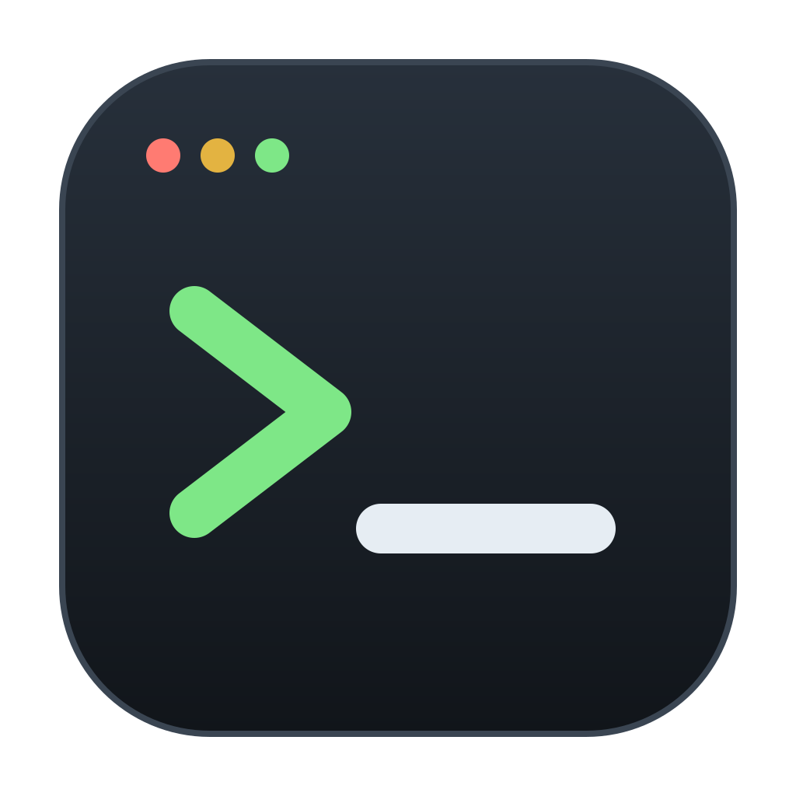
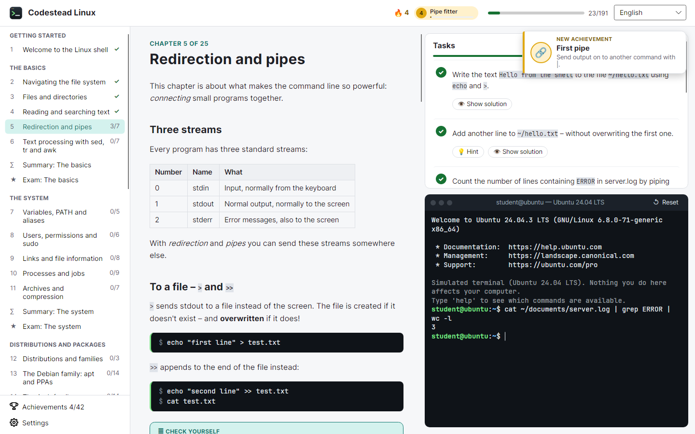

<p align="center"></p>

<h1 align="center">Codestead</h1>

<p align="center">
  <b>Learn by doing.</b> Desktop apps that teach programming topics chapter by chapter, with tasks you solve
  in a safe, built-in environment. The first one is <b>Codestead Linux</b>.
</p>

<p align="center">
  <a href="#download">Download</a> ·
  <a href="#features">Features</a> ·
  <a href="#languages">Languages</a> ·
  <a href="#repository-layout">Repository layout</a> ·
  <a href="#for-developers">For developers</a> ·
  <a href="#releasing">Releasing</a>
</p>

<p align="center"></p>

## Contents

- [What is Codestead?](#what-is-codestead)
- [Download](#download)
- [Features](#features)
- [Languages](#languages)
- [Repository layout](#repository-layout)
- [For developers](#for-developers)
  - [Build and run](#build-and-run)
  - [Tests](#tests)
  - [Adding a new tool](#adding-a-new-tool)
- [Releasing](#releasing)
- [License](#license)

## What is Codestead?

Codestead is a family of learning tools, plus a small launcher called the **Codestead hub**.

| App | What it does |
|---|---|
| **Codestead Linux** | Learn the Linux shell in a simulated terminal: 25 chapters, 191 tasks, checkpoints and exams. |
| **Codestead hub** | Installs, starts and updates the tools, and shows your level and achievements in each. |

More tools (such as Python and C++) are planned. They will share the same learning window, game and hub.

## Download

The installers are in the public repository
[JesperE98/codestead-releases](https://github.com/JesperE98/codestead-releases#readme).

**Easiest: install the Codestead hub.** It installs, starts and updates Codestead Linux (and later tools) for you.

| System | Codestead hub | Codestead Linux only |
|---|---|---|
| **Windows** 10/11 (x64) | [Setup.exe](https://github.com/JesperE98/codestead-releases/releases/download/codestead-hub-latest/codestead-hub-win-x64-Setup.exe) | [Setup.exe](https://github.com/JesperE98/codestead-releases/releases/download/codestead-linux-latest/codestead-linux-win-x64-Setup.exe) |
| **Ubuntu / Debian** | [.deb](https://github.com/JesperE98/codestead-releases/releases/download/codestead-hub-latest/codestead-hub_amd64.deb) | [.deb](https://github.com/JesperE98/codestead-releases/releases/download/codestead-linux-latest/codestead-linux_amd64.deb) |
| **Fedora** | [.rpm](https://github.com/JesperE98/codestead-releases/releases/download/codestead-hub-latest/codestead-hub.x86_64.rpm) | [.rpm](https://github.com/JesperE98/codestead-releases/releases/download/codestead-linux-latest/codestead-linux.x86_64.rpm) |
| **Arch Linux / CachyOS** | [.pkg.tar.zst](https://github.com/JesperE98/codestead-releases/releases/download/codestead-hub-latest/codestead-hub-x86_64.pkg.tar.zst) | [.pkg.tar.zst](https://github.com/JesperE98/codestead-releases/releases/download/codestead-linux-latest/codestead-linux-x86_64.pkg.tar.zst) |
| **Any Linux** (AppImage) | [.AppImage](https://github.com/JesperE98/codestead-releases/releases/download/codestead-hub-latest/codestead-hub-linux-x86_64.AppImage) | [.AppImage](https://github.com/JesperE98/codestead-releases/releases/download/codestead-linux-latest/codestead-linux-linux-x86_64.AppImage) |

Every release is installed and started automatically on clean systems before it is published:
Windows Server 2022/2025, Ubuntu 22.04 and 24.04, Fedora, Arch Linux and CachyOS. Installation notes:
[src/Linux/release-notes.md](src/Linux/release-notes.md) and [src/Hub/release-notes.md](src/Hub/release-notes.md).

## Features

**Codestead Linux**

- **A simulated Linux terminal** inside the app. Nothing needs to be installed, and nothing on your computer can break.
- **Four distributions in three families**: Ubuntu and Debian (`apt`), Arch Linux (`pacman`) and Fedora (`dnf`).
- **25 chapters with 191 tasks**: from your first commands to links, scripts, scheduled jobs, networking, file
  transfer, systemd, users, disks and git. Every chapter has checkpoints, and every part ends with an exam.
- **Helpful mistakes**: when a command is not found, the terminal tells you whether it is a typo
  ("did you mean `ls`?"), a real command the simulator does not have, or a package that is not installed.
- **XP, levels and achievements**: ten levels from Guest to root, 42 achievements (10 of them hidden), a day
  streak and a short celebration when you finish a chapter.
- Your progress is saved automatically. Light and dark theme.

**Codestead hub**

- Install, open, update and roll back tools; see what changed in each version.
- Your level, XP, streak and achievements for every tool, and a total.
- Can live in the system tray, start with the computer and install tool updates by itself.

## Languages

English (default), Swedish, Spanish, German, French, Chinese and Japanese.

Portuguese, Russian, Arabic and Hindi are paused until native speakers have checked them. Their texts stay in the
repository, so they can come back with one change in [build/languages.json](build/languages.json).

## Repository layout

Each app has its own folder; what several apps use lives in `src/Shared`.

```text
src/
├── Shared/   Codestead.Common       languages, translation, JSON settings, product info
│             Codestead.UI           theme and colours, controls, dialogs, game views, app shell
│             Codestead.Learning     the learning engine: course outline, XP, levels, streak, achievements
│             Codestead.Learning.UI  the learning window every tool shares
├── Linux/    Codestead.Linux        the app (LinuxTool: the Linux course and terminal in the shared window)
│             Codestead.Content      the Linux course: chapters, tasks, checks, achievements
│             Codestead.Shell        the simulated terminal (bash, zsh, fish, apt, pacman, dnf, git …)
│             Codestead.Terminal     the terminal control and the lesson sandbox
│             content/               chapter texts and translations
└── Hub/      Codestead.Hub, Codestead.Hub.Core
tests/        the same layout as src/
build/        names, versions, icons, languages.json
packaging/    build and install-test scripts, products.json, the release plan
docs/         DEVELOPMENT.md (developer guide, in Swedish), release checklist
```

## For developers

You need the [.NET 10 SDK](https://dotnet.microsoft.com/download).

### Build and run

```bash
dotnet run --project src/Linux/Codestead.Linux
```

```bash
dotnet run --project src/Hub/Codestead.Hub
```

### Tests

```bash
dotnet test
```

The smoke test opens the real window, renders every chapter in every language and solves a task:

```bash
dotnet run --project src/Linux/Codestead.Linux -- --smoke-test
```

### Adding a new tool

A new tool (for example C++) gets its own `src/<Tool>/` folder and implements `LearningTool`: its course, texts
and workbench. The learning window, the game, the settings and the hub come for free. See
"Så gör du ett nytt verktyg" in [docs/DEVELOPMENT.md](docs/DEVELOPMENT.md).

## Releasing

Merging to `main` does **not** publish anything; changes are collected into bigger releases.

1. Each pull request adds its lines to the changelog entry for the next version
   (`src/<App>/changelog.json`, in every offered language).
2. To release, run **Actions → Release → Run workflow** on `main` with **publish** ticked.
3. Every app that changed since its last release gets the next version (0.6.1, 0.6.2 …), is installed and
   tested on clean systems, and is published to
   [codestead-releases](https://github.com/JesperE98/codestead-releases). The apps update themselves from there.

## License

Copyright © 2026 JesperE98. All rights reserved – see [LICENSE](LICENSE).
