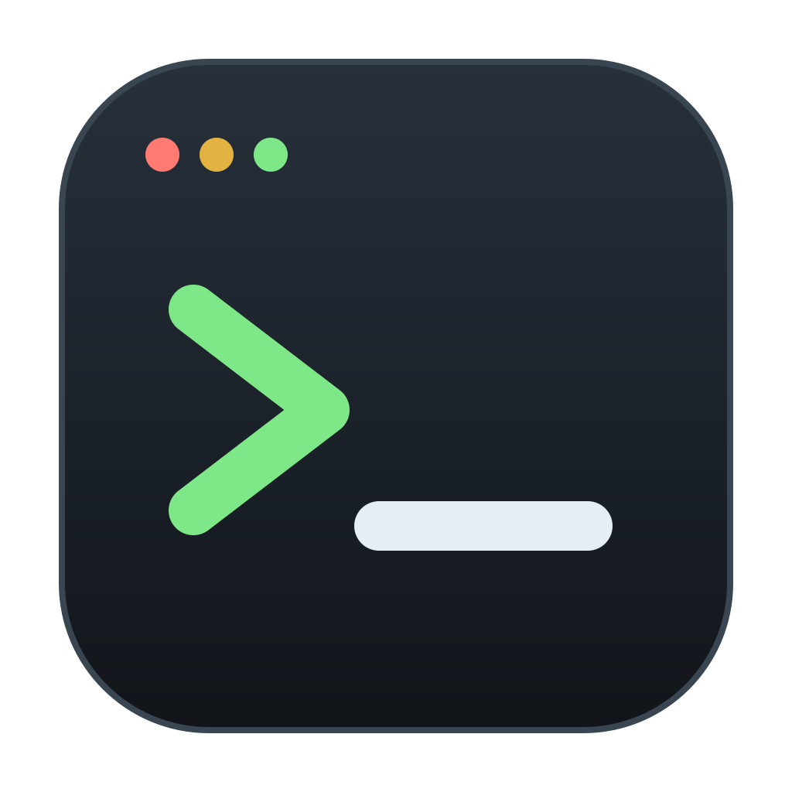
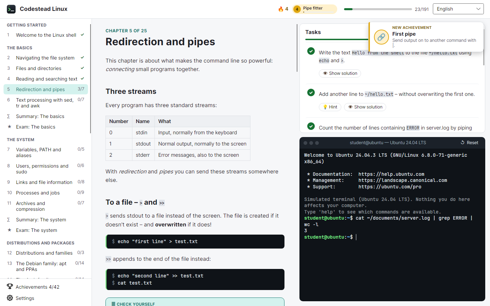

<p align="center"></p>

<h1 align="center">Codestead</h1>

<p align="center">
  <b>Learn by doing.</b> Desktop apps that teach programming topics chapter by chapter, with tasks you solve
  in a safe, built-in environment: <b>Codestead Linux</b> and <b>Codestead GP</b> (graphics programming).
</p>

<p align="center">
  <a href="#download">Download</a> ·
  <a href="#features">Features</a> ·
  <a href="#languages">Languages</a> ·
  <a href="#repository-layout">Repository layout</a> ·
  <a href="#for-developers">For developers</a> ·
  <a href="#releasing">Releasing</a>
</p>

<p align="center"></p>

## Contents

- [What is Codestead?](#what-is-codestead)
- [Download](#download)
- [Features](#features)
- [Languages](#languages)
- [Repository layout](#repository-layout)
- [For developers](#for-developers)
  - [Build and run](#build-and-run)
  - [Tests](#tests)
  - [Adding a new tool](#adding-a-new-tool)
- [Releasing](#releasing)
- [License](#license)

## What is Codestead?

Codestead is a family of learning tools, plus a small launcher called the **Codestead hub**.

| App | What it does |
|---|---|
| **Codestead Linux** | Learn the Linux shell in a simulated terminal: 25 chapters, 192 tasks, checkpoints and exams. |
| **Codestead GP** | Learn graphics programming with OpenGL, Vulkan or DirectX 12, following learnopengl.com, with a simulated GPU. *In development on the `GraphicsProgramming` branch.* |
| **Codestead hub** | Installs, starts and updates the tools, and shows your level and achievements in each. |

More tools (such as C++) are planned. They will share the same learning window, game and hub.

## Download

The installers are in the public repository
[JesperE98/codestead-releases](https://github.com/JesperE98/codestead-releases#readme).

**Easiest: install the Codestead hub.** It installs, starts and updates Codestead Linux (and later tools) for you.

| System | Codestead hub | Codestead Linux only |
|---|---|---|
| **Windows** 10/11 (x64) | [Setup.exe](https://github.com/JesperE98/codestead-releases/releases/download/codestead-hub-latest/codestead-hub-win-x64-Setup.exe) | [Setup.exe](https://github.com/JesperE98/codestead-releases/releases/download/codestead-linux-latest/codestead-linux-win-x64-Setup.exe) |
| **Ubuntu / Debian** | [.deb](https://github.com/JesperE98/codestead-releases/releases/download/codestead-hub-latest/codestead-hub_amd64.deb) | [.deb](https://github.com/JesperE98/codestead-releases/releases/download/codestead-linux-latest/codestead-linux_amd64.deb) |
| **Fedora** | [.rpm](https://github.com/JesperE98/codestead-releases/releases/download/codestead-hub-latest/codestead-hub.x86_64.rpm) | [.rpm](https://github.com/JesperE98/codestead-releases/releases/download/codestead-linux-latest/codestead-linux.x86_64.rpm) |
| **Arch Linux / CachyOS** | [.pkg.tar.zst](https://github.com/JesperE98/codestead-releases/releases/download/codestead-hub-latest/codestead-hub-x86_64.pkg.tar.zst) | [.pkg.tar.zst](https://github.com/JesperE98/codestead-releases/releases/download/codestead-linux-latest/codestead-linux-x86_64.pkg.tar.zst) |
| **Any Linux** (AppImage) | [.AppImage](https://github.com/JesperE98/codestead-releases/releases/download/codestead-hub-latest/codestead-hub-linux-x86_64.AppImage) | [.AppImage](https://github.com/JesperE98/codestead-releases/releases/download/codestead-linux-latest/codestead-linux-linux-x86_64.AppImage) |

Every release is installed and started automatically on clean systems before it is published:
Windows Server 2022/2025, Ubuntu 22.04 and 24.04, Fedora, Arch Linux and CachyOS – and installations of earlier
versions update themselves to it and keep your progress. Installation notes:
[src/Linux/release-notes.md](src/Linux/release-notes.md) and [src/Hub/release-notes.md](src/Hub/release-notes.md).

## Features

**Codestead Linux**

- **A simulated Linux terminal** inside the app. Nothing needs to be installed, and nothing on your computer can break.
- **Four distributions in three families**: Ubuntu and Debian (`apt`), Arch Linux (`pacman`) and Fedora (`dnf`).
- **25 chapters with 192 tasks**: from your first commands to links, scripts, scheduled jobs, networking, file
  transfer, systemd, users, disks and git. Every chapter has checkpoints, and every part ends with an exam.
- **Helpful mistakes**: when a command is not found, the terminal tells you whether it is a typo
  ("did you mean `ls`?"), a real command the simulator does not have, or a package that is not installed.
- **XP, levels and achievements**: ten levels from Guest to root, 42 achievements (10 of them hidden), a day
  streak and a short celebration when you finish a chapter.
- Your progress is saved automatically. Light and dark theme.

**Codestead GP** (in development)

- **Choose your graphics API** at the top – OpenGL 3.3, Vulkan or DirectX 12 – and every chapter, task and code
  example follows it. Each API has its own projects and progress.
- **The same chapters as learnopengl.com**, section by section. The OpenGL code follows learnopengl.com, the Vulkan
  code vulkan-tutorial.com and the DirectX 12 code Microsoft's D3D12 samples. So far: the introduction and Getting
  started up to Shaders.
- **A project editor with Build & run**: a simulated GPU compiles the code (misspelt API names get "did you mean"),
  runs the shaders and shows the window the program would open, with the messages a driver or validation layer
  would give.
- Every course project is compiled with the real compilers and headers, and the OpenGL and Vulkan ones are run on
  Mesa with the Khronos validation layer (`src/GP/verify`).

**Codestead hub**

- Install, open, update and roll back tools; see what changed in each version.
- Your level, XP, streak and achievements for every tool, and a total.
- Can live in the system tray, start with the computer and install tool updates by itself.

## Languages

English (default), Swedish, Spanish, German, French, Chinese and Japanese.

Portuguese, Russian, Arabic and Hindi are paused until native speakers have checked them. Their texts stay in the
repository, so they can come back with one change in [build/languages.json](build/languages.json).

## Repository layout

The apps are written in TypeScript with React and Electron, in the npm workspace `ts/`. Each app has its own folder
in `ts/apps`; what several apps use lives in `ts/packages`. The courses, texts and product files are in `src/`.

```text
ts/
├── packages/  common         languages, translation, the products (packaging/products.json)
│              learning       the learning engine: course outline, XP, levels, streak, achievements
│              ui             React: theme and colours, markdown view, dialogs, game views, the learning window
│                             every tool shares, self-update (Velopack)
│              linux-shell    the simulated terminal (bash, zsh, fish, apt, pacman, dnf, git …)
│              linux-content  the Linux course: chapters, tasks, checks, achievements
│              gp-gpu         the simulated GPU: compile step, GLSL/HLSL interpreter, rasteriser
│              gp-course      the GP course: chapters, tasks and checks, the learner's project
└── apps/      linux          Codestead Linux (Electron: the course and the terminal in the shared window)
               gp             Codestead GP (the course and the "Your project" panel)
               hub            the hub (catalog, downloads, installs, updates)
src/
├── Linux/    content/ (chapter texts and translations), UI and shell texts, changelog, release notes
├── GP/       content/ (chapter texts, translations, each chapter's projects per API), texts, changelog;
│             verify/ checks the course code with real compilers and drivers
└── Hub/      texts, icons, changelog, release notes
build/        icons, languages.json, the catalog's public key
packaging/    products.json (names, ids, versions), build, install and upgrade tests, the release plan
docs/         DEVELOPMENT.md (developer guide, in Swedish), release checklist, TYPESCRIPT-MIGRATION.md (history)
```

## For developers

You need [Node.js 22](https://nodejs.org) and npm.

### Build and run

```bash
cd ts
npm ci
cd apps/linux          # or apps/gp, apps/hub
npm run build
npm start              # as root (containers): npx electron . --no-sandbox
```

### Tests

```bash
cd ts
npm run typecheck
npm test
```

The smoke test opens the real window, renders every chapter in every language and solves a task; the end-to-end
tests drive the window with Playwright (installed globally, found through `NODE_PATH`):

```bash
cd ts/apps/linux
npm run smoke-test
npm run test:e2e
```

Codestead GP's TaskTests (every task of every chapter in every API through the simulated GPU, about an hour) run
only when asked: `CODESTEAD_GP_PARTS=pbr npx vitest run packages/gp-course/test/TaskTests.test.ts` in `ts/`
(`CODESTEAD_GP_CHAPTERS=bloom,ssao` for some chapters, `!bloom` to leave one out; CI runs them in eight parallel jobs).

### Adding a new tool

A new tool (for example C++) gets its own app in `ts/apps/`, a folder `src/<Tool>/` and an entry in
`packaging/products.json`, and implements `LearningTool`: its course, texts and workbench. The learning window, the
game, the settings and the hub come for free. See "Så gör du ett nytt verktyg" in [docs/DEVELOPMENT.md](docs/DEVELOPMENT.md).

## Releasing

Merging to `main` does **not** publish anything; changes are collected into bigger releases.

1. Each pull request adds its lines to the changelog entry for the next version
   (`src/<App>/changelog.json`, in every offered language).
2. To release, run **Actions → Release → Run workflow** on `main` with **publish** ticked.
3. Every app that changed since its last release gets the next version (0.6.1, 0.6.2 …), is installed and
   tested on clean systems, is updated to from installations of its last C# release and its previous release,
   and is published to
   [codestead-releases](https://github.com/JesperE98/codestead-releases). The apps update themselves from there.

## License

Copyright © 2026 JesperE98. All rights reserved – see [LICENSE](LICENSE).
