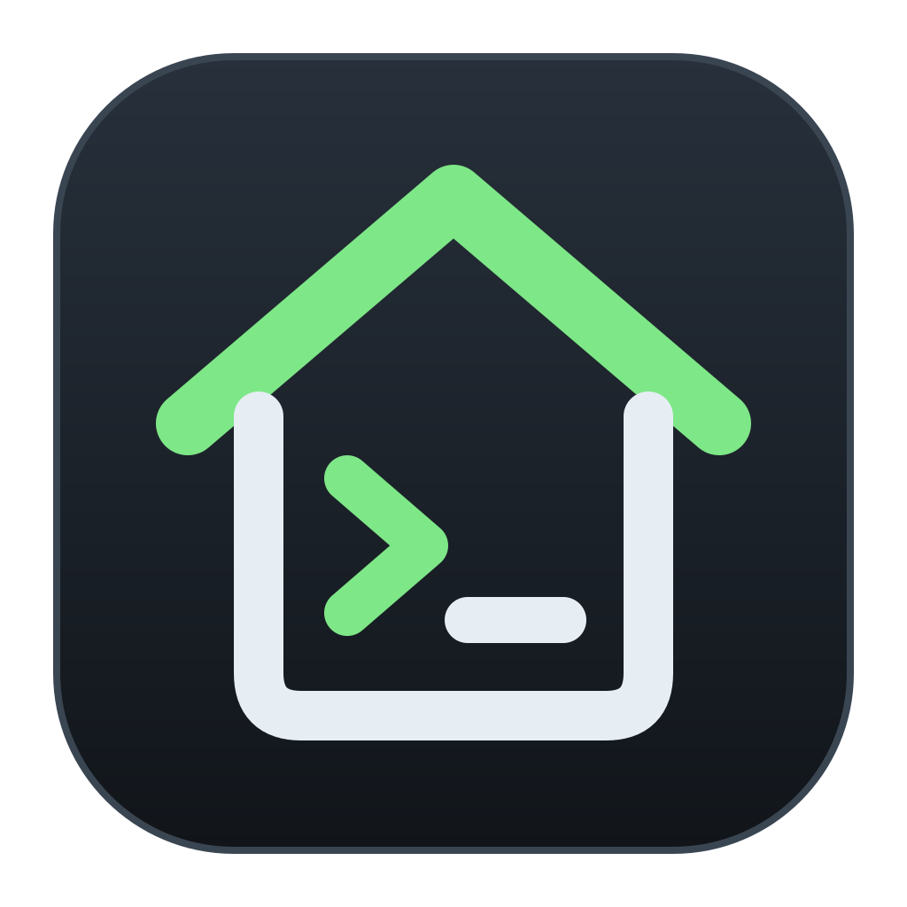

# Codestead Linux

Learn the Linux shell chapter by chapter, by doing. Codestead Linux is the first tool in
**Codestead**, a family of learning tools. More tools (such as Python and C#) are planned.

The structure is inspired by [learnopengl.com](https://learnopengl.com): chapters that build on
each other, with explanations and examples. Every chapter has **tasks** that you solve in a built-in,
simulated terminal. They are checked off automatically when you get them right (*learn by doing*).

## Download

The installers are in the public repository
[JesperE98/codestead-releases](https://github.com/JesperE98/codestead-releases/releases).

**Easiest: the "Codestead" hub.** It installs, starts and updates Codestead Linux (and more tools
later) for you.

| System | Codestead hub | Codestead Linux only |
|---|---|---|
| **Windows** 10/11 (x64) | [codestead-hub-win-x64-Setup.exe](https://github.com/JesperE98/codestead-releases/releases/download/codestead-hub-latest/codestead-hub-win-x64-Setup.exe) | [codestead-linux-win-x64-Setup.exe](https://github.com/JesperE98/codestead-releases/releases/download/codestead-linux-latest/codestead-linux-win-x64-Setup.exe) |
| **Ubuntu / Debian** | [codestead-hub_amd64.deb](https://github.com/JesperE98/codestead-releases/releases/download/codestead-hub-latest/codestead-hub_amd64.deb) | [codestead-linux_amd64.deb](https://github.com/JesperE98/codestead-releases/releases/download/codestead-linux-latest/codestead-linux_amd64.deb) |
| **Fedora** | [codestead-hub.x86_64.rpm](https://github.com/JesperE98/codestead-releases/releases/download/codestead-hub-latest/codestead-hub.x86_64.rpm) | [codestead-linux.x86_64.rpm](https://github.com/JesperE98/codestead-releases/releases/download/codestead-linux-latest/codestead-linux.x86_64.rpm) |
| **Arch Linux / CachyOS** | [codestead-hub-x86_64.pkg.tar.zst](https://github.com/JesperE98/codestead-releases/releases/download/codestead-hub-latest/codestead-hub-x86_64.pkg.tar.zst) | [codestead-linux-x86_64.pkg.tar.zst](https://github.com/JesperE98/codestead-releases/releases/download/codestead-linux-latest/codestead-linux-x86_64.pkg.tar.zst) |
| **Any Linux** (AppImage) | [codestead-hub-linux-x86_64.AppImage](https://github.com/JesperE98/codestead-releases/releases/download/codestead-hub-latest/codestead-hub-linux-x86_64.AppImage) | [codestead-linux-linux-x86_64.AppImage](https://github.com/JesperE98/codestead-releases/releases/download/codestead-linux-latest/codestead-linux-linux-x86_64.AppImage) |

Every release is automatically installed and started on clean systems before it is published: Windows
Server 2022/2025, Ubuntu 22.04 and 24.04, Fedora, Arch Linux and CachyOS. The hub is also tested by
having it install and start Codestead Linux. See [.github/release-notes/](.github/release-notes/)
for installation instructions.

## What you get

- **A simulated Linux terminal** inside the app. Nothing needs to be installed, and nothing on your computer can break.
- **Four distributions in three families**: Ubuntu and Debian (`apt`), Arch Linux (`pacman`) and Fedora (`dnf`).
- **21 chapters with 140 tasks**: from your first commands to scripts, networking, systemd, users, disks and git.
- **11 languages**: English (default), Swedish, Spanish, Chinese, Hindi, Arabic, Portuguese, French, German, Russian and Japanese.
- Your progress is saved automatically. Light and dark theme.

## License

Copyright © 2026 JesperE98. All rights reserved – see [LICENSE](LICENSE).
