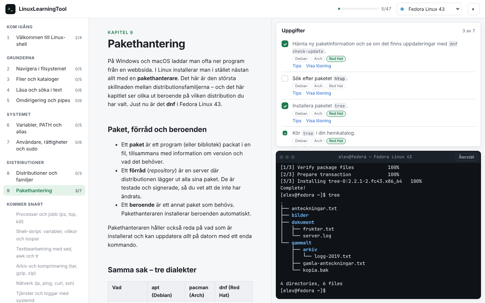

# LinuxLearningTool

Lär dig Linux-shell kapitel för kapitel – i webbläsaren eller som skrivbordsapp
för Windows, macOS och Linux.

Upplägget är inspirerat av [learnopengl.com](https://learnopengl.com): kapitel
som bygger på varandra, med förklaringar och exempel. Varje kapitel har
**uppgifter** som du löser i en inbyggd terminal, och som bockas av automatiskt
när du gjort rätt (*learn by doing*).



## Ladda ner

Installera LinuxLearningTool som ett vanligt program. Välj ditt operativsystem:

| | Ladda ner |
|---|---|
| **Windows** 10/11 | [LinuxLearningTool-Setup-Windows.exe](https://github.com/jesper-e98/LinuxLearningTool/releases/latest/download/LinuxLearningTool-Setup-Windows.exe) |
| **macOS** | Kommer snart – tills vidare kan du bygga själv med `npm run app:dist:mac` på en Mac |
| **Linux** (x86_64) | [LinuxLearningTool-Linux-x86_64.AppImage](https://github.com/jesper-e98/LinuxLearningTool/releases/latest/download/LinuxLearningTool-Linux-x86_64.AppImage) |

Alla versioner finns under [Releases](https://github.com/jesper-e98/LinuxLearningTool/releases).
Appen är inte signerad än, så Windows varnar första gången – se
[instruktionerna](.github/release-notes.md#första-starten).

## Funktioner

- **Simulerad Linux-terminal** direkt i webbläsaren – fungerar på alla
  operativsystem, även Windows, utan att något installeras och utan att något
  kan gå sönder. Stöd för pipes, omdirigering, jokertecken, variabler, alias,
  skript, rättigheter och `sudo`.
- **Fyra distributioner i tre familjer**: Ubuntu och Debian (`apt`), Arch Linux
  (`pacman`) och Fedora (`dnf`). Prompten, filerna i `/etc`, paketnamnen och
  pakethanterarens utskrifter följer respektive distribution.
- **Distro-medvetet innehåll**: kapitlen visar olika avsnitt beroende på vald
  familj, och distro-uppgifterna räknas separat per familj.
- **10 kapitel** och **54 uppgifter**, med tips och lösningar.
- Framsteg och terminalens tillstånd sparas lokalt (localStorage).
- Ljust och mörkt tema, fungerar på mobil.

### Kapitel

| Del | Kapitel |
|---|---|
| Kom igång | 1. Välkommen till Linux-shell |
| Grunderna | 2. Navigera i filsystemet · 3. Filer och kataloger · 4. Läsa och söka i text · 5. Omdirigering och pipes · 6. Textbearbetning med sed, tr och awk |
| Systemet | 7. Variabler, PATH och alias · 8. Användare, rättigheter och sudo |
| Distributioner | 9. Distributioner och familjer · 10. Pakethantering (apt / pacman / dnf) |

## Kom igång

Kräver [Node.js](https://nodejs.org) 20 eller senare.

```bash
npm install
```

```bash
npm run dev
```

Öppna sedan adressen som visas (normalt http://localhost:5173).

### Andra kommandon

| Kommando | Gör |
|---|---|
| `npm test` | Kör alla tester (skalet, pakethanterarna och alla kapiteluppgifter) |
| `npm run build` | Bygger webbversionen till `dist/` – kan läggas på vilken statisk webbserver som helst |
| `npm run app` | Bygger och startar skrivbordsappen (Electron) |
| `npm run app:dist` | Bygger installationsfiler för ditt operativsystem till `release/` |

### Bygga installationsfilerna själv

Skrivbordsappen är samma webbapp inpackad med [Electron](https://www.electronjs.org),
och [electron-builder](https://www.electron.build) skapar installationsfilerna:

| Operativsystem | Fil | Kommando |
|---|---|---|
| Windows | Installationsguide (`.exe`) där man väljer mapp och genvägar | `npm run app:dist:win` |
| macOS | `.dmg` för både Intel och Apple Silicon | `npm run app:dist:mac` |
| Linux | `.AppImage` som körs direkt | `npm run app:dist:linux` |

Filerna hamnar i `release/`. Varje operativsystem måste byggas på sig självt,
så det enklaste är att låta GitHub göra det.

### Släppa en ny version

1. Höj `version` i `package.json`, till exempel från `0.1.0` till `0.2.0`.
2. Slå ihop ändringen till `main`.

Flödet `.github/workflows/release.yml` bygger då installationsfilerna och
lägger upp dem som release `v0.2.0`. Finns releasen redan händer ingenting.
Flödet kan också startas för hand under **Actions → Bygg skrivbordsappar →
Run workflow**. Ikonen ligger i `build/icon.svg` (och `build/icon.png`).

## Projektstruktur

```text
src/
├── shell/                 Den simulerade terminalen
│   ├── shell.ts           Kör kommandorader: pipes, omdirigering, sudo, skript
│   ├── parser.ts          Tolkar kommandorader (citattecken, operatorer)
│   ├── vfs.ts             Virtuellt filsystem med ägare och rwx-rättigheter
│   ├── initfs.ts          Startfilerna för varje distribution
│   ├── distros.ts         Ubuntu, Debian, Arch och Fedora
│   ├── packages.ts        Paketdatabasen (med olika paketnamn per familj)
│   └── commands/          Alla kommandon: ls, grep, chmod, apt, pacman, dnf ...
├── content/
│   ├── chapters/*.md      Kapiteltexterna (markdown)
│   ├── chapters.ts        Kapitlen och deras uppgifter
│   ├── progress.ts        Kontrollerar uppgifter efter varje kommando
│   └── render.ts          Markdown → HTML, med distro-block
├── components/            React-komponenter (meny, lektion, uppgifter, terminal)
└── App.tsx
electron/main.cjs          Skrivbordsappens startfil
```

## Skriva ett nytt kapitel

1. Skapa `src/content/chapters/10-mitt-kapitel.md`.
   - Kodblock märkta ` ```sh ` blir klickbara – ett klick lägger in kommandot i terminalen.
   - Text som bara gäller en familj läggs i ett block:

     ```text
     :::debian
     Det här visas bara för Debian och Ubuntu.
     :::
     ```

     (även `:::arch` och `:::redhat`).
   - Platshållare: `{{distro}}`, `{{hostname}}`, `{{family}}`, `{{pm}}`, `{{adminGroup}}`.
2. Lägg till kapitlet i `CHAPTERS` i `src/content/chapters.ts` med uppgifter.
   Varje uppgift har en `check`-funktion som körs efter varje kommando, och en
   `solution` (lista med kommandon).
3. Kör `npm test`. Testet kör alla lösningar i alla distributioner och
   kontrollerar att varje uppgift faktiskt går att klara.

Behövs ett nytt kommando lägger du det i `src/shell/commands/`. Ska det
installeras med pakethanteraren lägger du också till ett paket i
`src/shell/packages.ts`.

## Färdplan

- [ ] Processer och jobb (`ps`, `top`, `kill`, `&`, `jobs`)
- [ ] Shell-skript: variabler, `if`, loopar och funktioner
- [x] Textbearbetning med `sed`, `awk` och `tr`
- [ ] Arkiv och komprimering (`tar`, `gzip`, `zip`)
- [ ] Nätverk (`ip`, `ping`, `curl`, `ssh`)
- [ ] Tjänster och loggar med systemd (`systemctl`, `journalctl`)
- [ ] Diskar och filsystem (`df`, `du`, `mount`, `lsblk`)
- [ ] Användarhantering (`useradd`, `passwd`)
- [ ] Andra skal: zsh och fish
- [ ] AUR, PPA och COPR · Flatpak, Snap och AppImage
- [ ] Fler distributioner: Linux Mint, openSUSE (`zypper`), Alpine (`apk`)
- [ ] Engelsk översättning
- [ ] Valfritt läge med en riktig Linux i webbläsaren (t.ex. v86/WebVM)

## Licens

Fri programvara utan förbehåll – se [LICENSE](LICENSE) (The Unlicense).
